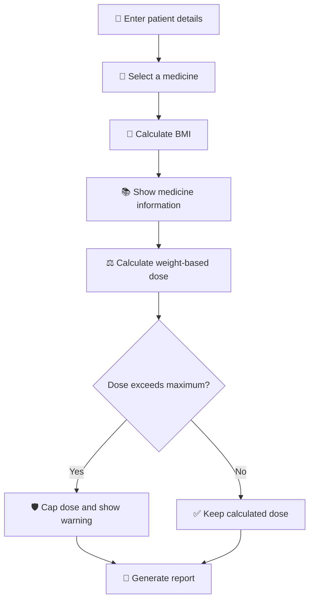

# 🏥 Pharma Dosage Calculator

A beginner-friendly **Streamlit** application for exploring BMI calculation,
medicine information, and simplified weight-based dosage calculations.

> ⚠️ **Educational use only:** This project is a software demonstration. It is
> not a medical diagnostic tool and must not be used to prescribe medication or
> make real treatment decisions.

## ✨ What this app does

The application allows a user to:

- Enter a patient's name, age, weight in **kilograms**, and height in
  **centimeters**.
- Calculate the patient's BMI and display the corresponding BMI category.
- Select one of four medicines from the drug database.
- View educational information about the selected medicine.
- See common uses and conditions where the medicine may be prescribed.
- Calculate a simplified weight-based daily dose.
- Apply a configured maximum daily limit.
- Generate a formatted prescription-style report.

## 🧭 Application workflow



### 1. 👤 Enter patient details

The user enters:

- Patient name
- Age in years
- Weight in kilograms
- Height in centimeters

### 2. 💊 Select a medicine

The user selects one medicine from:

- Amoxicillin
- Ibuprofen
- Paracetamol
- Azithromycin

The app then displays educational information about the selected medicine,
including its class, common uses, relevant conditions, and limitations.

### 3. 📊 Calculate BMI

Height is converted from centimeters to meters and BMI is calculated as:

```text
BMI = weight (kg) / height (m)²
```

The app displays:

- BMI value
- BMI category
- A progress indicator
- Standard adult BMI ranges

The BMI categories shown by the app are:

| BMI | Category |
|---:|---|
| Below 18.5 | Underweight |
| 18.5–24.9 | Healthy range |
| 25–29.9 | Overweight |
| 30–34.9 | Obese |
| 35 or above | Extremely obese |

> BMI is an informational screening measure. In this application, BMI is not
> used to determine the medication dose.

### 4. ⚖️ Calculate the simplified dose

The demonstration dosage calculation uses:

```text
Calculated dose = weight (kg) × medicine dose (mg/kg)
```

If the calculated amount exceeds the configured maximum daily limit, the app
reduces the displayed amount to that limit and shows a warning.

### 5. 📝 Generate the report

After clicking **Calculate Safe Dosage & Print Rx**, the app displays:

- Patient name and age
- Weight and height
- BMI
- Selected medicine
- Recommended daily dose
- Safety warning, when the configured maximum is reached

## 💊 Current medicine database

| Medicine | Class | Demonstration rule | Maximum daily amount |
|---|---|---:|---:|
| Amoxicillin | Penicillin-type antibiotic | 20 mg/kg | 1000 mg |
| Ibuprofen | NSAID | 10 mg/kg | 1200 mg |
| Paracetamol | Analgesic and antipyretic | 15 mg/kg | 4000 mg |
| Azithromycin | Macrolide antibiotic | 10 mg/kg | 500 mg |

These values are simplified project data and are **not validated prescribing
guidelines**.

## 🗂️ Project structure

```text
Pharma_app/
├── app.py                 # Streamlit user interface
├── main.py                # Application orchestration
├── patient.py             # Patient profile creation
├── drug_database.py       # Medicine rules and educational details
├── dosage.py              # Weight-based dose calculation
├── reports.py             # Prescription-style report generation
├── utils.py               # BMI calculation and categorization
├── requirements.txt       # Python dependencies
└── README.md              # Project documentation
```

## 🛠️ Run locally

### Prerequisites

- Python 3.10 or newer
- Internet access for installing Streamlit

### 1. Open the project directory

Windows PowerShell:

```powershell
cd "e:\bpharm\2\Pharma_app"
```

For another computer, replace the path with the location where the project
was downloaded.

### 2. Create and activate a virtual environment

Windows PowerShell:

```powershell
python -m venv .venv
.\.venv\Scripts\Activate.ps1
```

If PowerShell blocks activation, you can run Streamlit through the environment
directly:

```powershell
.\.venv\Scripts\python.exe -m pip install -r requirements.txt
.\.venv\Scripts\python.exe -m streamlit run app.py
```

### 3. Install dependencies

```powershell
python -m pip install -r requirements.txt
```

### 4. Start the application

```powershell
python -m streamlit run app.py
```

Streamlit will print a local address, usually:

```text
http://localhost:8501
```

Open that address in a browser.

## ☁️ Deploy publicly with Streamlit Community Cloud

This project can be deployed publicly using a public GitHub repository.

### 1. Create a GitHub repository

Create a new repository, for example:

```text
pharma-dosage-calculator
```

Because this project is intended to be public, choose **Public** when creating
the repository. Do not upload private patient data, secrets, passwords, API
keys, or generated local files.

### 2. Upload the project files

Upload the Python files, `requirements.txt`, and `README.md`:

```text
app.py
main.py
patient.py
drug_database.py
dosage.py
reports.py
utils.py
requirements.txt
README.md
```

Do not upload:

```text
.venv/
__pycache__/
*.pyc
*.out
*.err
```

### 3. Deploy the app

1. Open [Streamlit Community Cloud](https://share.streamlit.io/).
2. Sign in with GitHub.
3. Select **Create app**.
4. Choose your repository and branch.
5. Set the main file to `app.py`.
6. Select **Deploy**.

Streamlit Community Cloud will install the dependency listed in
`requirements.txt` and provide a shareable application URL.

## 📦 Dependencies

The app uses:

- [Streamlit](https://streamlit.io/) for the web interface
- Python standard-library modules for the calculation and application logic

Install the dependency with:

```powershell
python -m pip install -r requirements.txt
```

## 🔒 Privacy and responsible use

This public application does not provide authentication, patient-data
encryption, audit logging, or healthcare compliance controls.

Please:

- Use fictional or test patient information.
- Do not enter real patient names or sensitive health information.
- Do not treat the generated output as a prescription.
- Consult a qualified healthcare professional for real medication decisions.
- Verify diagnosis, allergies, interactions, contraindications, formulation,
  age-specific guidance, kidney/liver function, and treatment duration.

## 🚧 Limitations and future improvements

Possible future improvements include:

- More comprehensive and verified medicine data.
- Formulation and route selection.
- Frequency and duration fields.
- Allergy and interaction checks.
- Age-specific and renal/hepatic dosing rules.
- User authentication and secure data handling.
- Automated tests and clinical review.

## 📄 License

Add a license before distributing the repository. For an open-source project,
the [MIT License](https://choosealicense.com/licenses/mit/) is a common
starting point, but choose a license that matches your goals.

